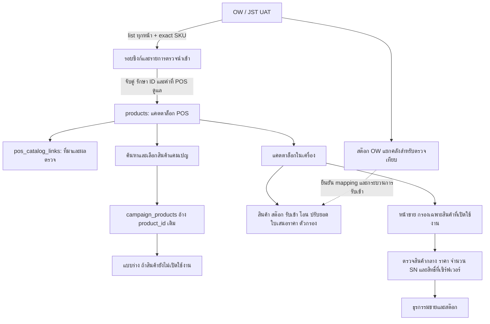

# ตรวจการใช้แคตตาล็อก OW ใน POS — 22 พฤศจิกายน 2026

## ข้อสรุป

รอบนำเข้า 33 SKU ลงตาราง `products` ของ POS แล้ว มี `product_id` จริงและผูกต้นทางใน `pos_catalog_links` จึงต้องใช้รหัสนี้ต่อในแคมเปญ บิล และเอกสารสต๊อก ไม่สร้างแคตตาล็อก OW อีกชุดแยกจากงานปฏิบัติการ

ทดสอบหน้าแคมเปญจริง: MOVA ค้นหาได้อยู่แล้ว แต่ SKU `70mai essential-35%` ถูกโค้ดค้นหาเดิมแทน `%` เป็นช่องว่าง จึงค้นหาไม่เจอ ทั้งที่มีข้อมูลอยู่ การโหลดล้มเหลวยังถูกแสดงเหมือนไม่มีผลลัพธ์ และไม่มีสถานะอธิบายว่าสินค้านำเข้าแต่ยังปิดขาย

ข้อมูล OW ในรอบนี้มาจาก UAT ราคาขาย 0 และนโยบาย SN ยังไม่ระบุ การมีสินค้ากลางจึงไม่เท่ากับอนุมัติให้ขายหรือยืนยันยอดสินค้าคงเหลือ

## เส้นทางข้อมูลที่ใช้

## แก้แล้วในรอบนี้

| ส่วน | สิ่งที่แก้ | ขอบเขตการใช้งาน |
|---|---|---|
| ค้นหาสินค้า | ค้นหา SKU/ชื่อ/ชื่อย่อโดยรักษา `%`, `_`, วงเล็บ เครื่องหมายคำพูด และ backslash | ใช้ `products` กลาง รวมรายการนำเข้าที่ยังไม่เปิดขาย |
| ตัวเลือกแคมเปญ | แสดงรายการเริ่มต้น แหล่ง OW UAT สถานะสินค้า ข้อผิดพลาด และลองใหม่ | ไม่ปล่อย API error ให้ดูเหมือนไม่พบสินค้า |
| สินค้าในแคมเปญ | ใช้ `product_id` จริง ตรวจ SKU ให้ตรง และอ่านชื่อจากฐานข้อมูล | ปฏิเสธรหัสปลอม รายการซ้ำ และจำนวนของแถมไม่ถูกต้อง |
| แบบร่าง | เลือกสินค้าปิดขายแล้วตั้งแคมเปญเป็นแบบร่าง | ฝั่งเซิร์ฟเวอร์ปฏิเสธการเปิดแคมเปญที่ยังอ้างสินค้าปิดใช้งาน ทั้ง POST และ PATCH |
| หน้าปฏิบัติการ | ใช้ hook ติดตาม `pos-catalog-refreshed` ร่วมกัน | สินค้า ตัวกรองรายงาน คลังกลาง โอน สต๊อก รับเข้า ปรับยอด คืนสินค้า และใบเสนอราคา อัปเดตจากแคตตาล็อกเดียวกัน |
| การรีเฟรช | เปลี่ยน automatic full reset เป็น catalog refresh | ไม่ล้างบิลพัก ออเดอร์ งานโอน และคิวงานที่ยังไม่ซิงก์ |
| โปรโมชั่นตัวอย่าง | หยุด fallback แคมเปญ/ประวัติจำลองในโหมดใช้งานจริง | เมื่อยังไม่มีธุรกรรมจริงให้แสดงว่าง |
| รายงานคูปอง | อ่านเลขบิล ลูกค้า และสินค้าจาก redemption → orders → order_items | ยกเลิกการสุ่มชื่อ/สินค้า/เลขบิลประกอบรายงาน หากไม่มีบิลให้ระบุข้อมูลไม่พร้อม |
| นับการจับคู่ OW | นับ found / missing จากผลตรวจ SKU | แยกรอตรวจ อ่านล้มเหลว และอ่านยอดสต๊อกไม่ได้ ออกจากการไม่พบสินค้า |
| ของแถม | ไม่สร้างรายการของแถมจากสินค้าปิดใช้งาน | ช่วยป้องกันรายการรอตรวจหลุดเข้าตะกร้า |

## งานที่ยังต้องทำก่อนใช้งานจริงครบวงจร

### 1. หน้าตรวจและอนุมัติข้อมูลสินค้า

หน้าสินค้าหลักยังเป็นรายการอ่านข้อมูล ต้องเพิ่มขั้นตอนแก้ไข/ยืนยันราคา VAT หน่วย แบรนด์ หมวดหมู่ บาร์โค้ด และนโยบาย SN พร้อมผู้อนุมัติและประวัติ การเลือก “ไม่ใช้ SN” ต้องมีหลักฐานยืนยัน แยกจากค่าเริ่มต้น false ที่เกิดจากต้นทางยังไม่ระบุ ห้ามใช้ราคาหรือค่า SN สมมุติเพียงเพื่อเปิดขาย

รองรับราคาหน้าร้าน ราคาสมาชิก และราคาส่งอย่างมีนโยบายว่าใครเป็นเจ้าของค่าใด การซิงก์ครั้งต่อไปต้องไม่เขียนทับราคาที่ POS อนุมัติเองโดยไม่มีคำสั่ง

### 2. คลังและสต๊อกจริง

ยืนยัน `warehouse_id` ของ OW ว่าตรงกับสาขา POS ใด รหัสคลังที่มีใน UAT ไม่ใช่หลักฐานว่าเป็นสาขาจริงของบริษัท การนำเข้าสินค้าไม่ลงยอด On Hand โดยอัตโนมัติ

ต้องกำหนดเอกสารรับเข้าหรือยอดตั้งต้นที่อ้าง SKU/SN จริง ตรวจยอดและเจ้าของข้อมูล แยกยอด OW สำหรับตรวจเทียบออกจาก ledger POS รักษา Reserved Order / Reserved Out / On the Way Out และไม่หักซ้ำ

### 3. SN และการส่งเหตุการณ์กลับ OW

ยืนยันกระบวนการจริงด้วยสินค้ามี SN และไม่มี SN ตั้งแต่รับจากคลังกลาง สแกนตามใบส่ง พบส่วนต่าง พักตรวจ ส่งคืน โอนสาขา และขาย สินค้ารับเข้าใช้ product_id เดิมแต่แต่ละ SN มีประวัติและตำแหน่งของตนเอง

การส่งกลับ OW ต้องมีรหัสเหตุการณ์ไม่ซ้ำ คิวส่ง ลองใหม่ ผลตอบรับ และหน้าติดตามรายการค้าง ต้องตรวจความสามารถ write API/สัญญาข้อมูลร่วมกับ OW แยกจากความสำเร็จของ read catalog

### 4. โปรโมชั่นกับการชำระเงินจริง — จุดขาดสำคัญ

`validateQuote` ฝั่งเซิร์ฟเวอร์ยังปฏิเสธบิลที่ใช้คูปอง/แต้ม จึงยังไม่ใช่การใช้แคมเปญครบวงจร แม้จะเลือกสินค้าและบันทึกแคมเปญได้แล้ว

ต้องรวมการตรวจ SKU/แบรนด์/สาขา/เวลา/ช่องทาง/ลูกค้า จำนวนขั้นต่ำ ส่วนลด เพดานใช้ สิทธิ์ ของแถม สต๊อก และ SN ใน quote ฝั่งเซิร์ฟเวอร์ จากนั้น commit การขายพร้อมการใช้สิทธิ์ใน transaction เดียวกัน รองรับยิงซ้ำ ยกเลิก และคืนสินค้า UI ต้องใช้ผลคำนวณเดียวกับเซิร์ฟเวอร์

รอบนี้หยุดแสดงโปรโมชั่นตัวอย่างในโหมดจริงแล้ว ยังไม่ได้เปิดการชำระเงินด้วยคูปองแทนข้อจำกัดนี้

### 5. บันทึกแคมเปญแบบ atomic

การตรวจสินค้าเพิ่มแล้ว แต่ CRUD เดิมยังเขียน campaigns และ campaign_products คนละคำสั่ง ต้องย้ายเป็น transaction/RPC เดียว พร้อม version check ป้องกันเขียนชน เพื่อไม่ให้เกิดเอกสารครึ่งเดียวเมื่อการเขียน relations ล้มเหลว

### 6. สิทธิ์และการตรวจรับงาน

ปัจจุบัน API แคมเปญ/ค้นหาใช้ guard ผู้ดูแลเดิม ต้องออกแบบสิทธิ์จัดการแคมเปญโดยเฉพาะและตรวจขอบเขตแบรนด์/สาขาทั้งการอ่านและเขียนก่อนมอบให้ทีมอื่น รายงานปริมาณมากยังควรเปลี่ยนเป็นการ aggregate/paginate ที่ฐานข้อมูลและแสดงข้อจำกัดจำนวนรายการชัดเจน

## เกณฑ์ตรวจรับ “ใช้ OW เป็นส่วนหนึ่งของ POS”

1. SKU เดียวมี product_id เดียวตั้งแต่นำเข้า ค้นหา แคมเปญ บิล และเอกสารสต๊อก
2. ซิงก์ซ้ำไม่สร้างสินค้าใหม่ ไม่ล้างข้อมูล POS และไม่ทำให้งาน offline หาย
3. พนักงานเห็นสินค้าตามสิทธิ์ และรู้ว่ารายการไหนนำเข้าแล้ว/ปิดใช้งาน/พร้อมขาย
4. สแกน SN จริงครบจำนวน ตรวจสินค้าและตำแหน่งตรง พร้อมเส้นทางผลต่าง/คืนสินค้า
5. ยอดเงินก่อนจ่ายตรงกับ quote เซิร์ฟเวอร์ คูปอง/ของแถมใช้สิทธิ์ครั้งเดียวพร้อมบิล
6. สต๊อกและเหตุการณ์ส่งกลับ OW มีเลขอ้างอิง ตรวจย้อนหลังและ retry ได้ ไม่ตัดยอดซ้ำ
7. รายงานอ้างอิงรายการจริงทุกบรรทัด ไม่เติมข้อมูลจำลองเมื่อค้นไม่พบ

## หลักฐานการตรวจรอบนี้

- ทดสอบ UI จริง: ค้นหา `70mai essential-35%` พบ → เลือกสินค้า → แสดง OW UAT และแบบร่าง → ช่องเปิดใช้งานถูกปิดให้
- ทดสอบ query จริงกับฐานข้อมูล: SKU มี `%` และ SKU มีช่องว่างค้นหาได้
- ตรวจ schema จริงแบบอ่านอย่างเดียวสำหรับ orders / order_items / coupon_redemptions
- Regression ครอบคลุม canonical identity, inactive draft, activation rejection, input tampering, duplicate references, failed reads before writes, safe bootstrap และรายงานที่ใช้ order snapshot จริง
- ไม่สร้างแคมเปญทดลอง ไม่เปิดขายสินค้า และไม่เพิ่มยอดสต๊อกจริงในรอบนี้

ผลตรวจท้ายรอบ: `npm --prefix web run test:readiness` ผ่าน รวมการทดสอบแคตตาล็อก ธุรกรรมขาย ฐานข้อมูล 40 migrations และ TypeScript; หลังปรับเงื่อนไขแคมเปญครั้งสุดท้าย รันทดสอบ integration และ TypeScript ซ้ำผ่านแล้ว ไม่มี migration ใหม่ในรอบนี้
