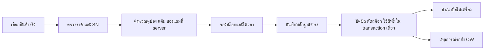

# POS operational readiness — 22 November 2026

## ผลที่ทำและเปิดใช้ใน local

ติดตั้ง migration 0041, 0042 และ 0043 กับฐานข้อมูลที่ local POS ใช้อยู่แล้ว การติดตั้งแต่ละครั้งใช้ transaction และหยุดเมื่อ SQL ผิดพลาด ไม่ได้ deploy ตัวเว็บขึ้น production

- หน้าสินค้ามีฟอร์มตรวจราคา ต้นทุน แบรนด์ หมวดหมู่ หน่วย นโยบาย SN ประเภท และสถานะเปิดขาย
- การแก้สินค้าต้องมีเหตุผล มีประวัติก่อน/หลัง และตรวจเวอร์ชันเพื่อไม่เขียนทับการแก้ของคนอื่น
- ยังไม่ยืนยัน SN แสดงแยกจาก “ไม่ใช้ SN”; ไม่มีการถือว่าข้อมูล null คือ false
- เปิดขายต้องมีราคาบวก แบรนด์ หมวดหมู่ และยืนยัน SN; ประเภทที่ต้นทางยังไม่ยืนยันต้องตรวจเพิ่ม
- เปลี่ยนนโยบาย SN ไม่ได้เมื่อมีสต๊อก SN หรือการจองที่ต้องกระทบยอด
- สินค้าชุดยังปิดทางขายจนกว่าจะมี BOM และการตัดส่วนประกอบที่ผ่านการทดสอบ
- ไม่ได้เดาราคาหรือ SN และไม่ได้เปิดขาย 33 SKU ที่นำเข้าจาก UAT

## วิธีใช้งานสินค้า

1. เปิด `/admin/products` แล้วค้น SKU
2. กด “ตรวจและตั้งค่า”
3. กรอกราคา/ต้นทุนที่อนุมัติจริง เลือกแบรนด์และหมวดหมู่
4. เลือก “ต้องสแกน SN ทุกชิ้น” หรือ “ไม่ใช้ SN” จากหลักฐานจริง
5. ตรวจประเภทสินค้า ระบุเหตุผล และบันทึก จะบันทึกเป็นรายการปิดขายไว้ก่อนได้
6. เปิดขายเมื่อข้อมูลผ่านการตรวจแล้ว ยอดสินค้าแต่ละสาขายังต้องมาจากการรับเข้า/ยอดยกมาที่อนุมัติ
7. ถ้าถูกแก้โดยคนอื่น จะต้องโหลดข้อมูลล่าสุดและตรวจใหม่

การอนุมัติข้อมูลสินค้าไม่ใช่การรับสินค้าจริงเข้าคลัง และไม่ใช่หลักฐานว่าของมีอยู่ที่สาขา

## แคมเปญและ Checkout กลาง

การบันทึกหัวแคมเปญและสินค้าร่วม/ของแถมใช้ธุรกรรมเดียว ถ้าบันทึกส่วนใดผิด จะยกเลิกทั้งธุรกรรม การแก้ต้องใช้ version ล่าสุด การลบเป็นการเก็บเข้าประวัติพร้อมปิดใช้งาน โดยรักษาประวัติการใช้เดิม



- ทั้งคูปองที่พิมพ์และแคมเปญที่กดเลือกตรวจที่ server
- ตรวจเวลาไทย สาขา ช่องทาง กลุ่มลูกค้า SKU/แบรนด์ จำนวนขั้นต่ำ ยอดขั้นต่ำ และโควตา
- ส่วนลดคูปองคิดจากส่วนของยอดสุทธิที่ร่วมรายการ หลังส่วนลดพนักงาน
- เมื่อเปลี่ยนตะกร้าแล้วส่วนลดเปลี่ยน จะปรับยอดและให้ตรวจยอดอีกครั้งก่อนรับเงิน
- จองโควตาไว้กับ checkout ที่ยังมีผล การต่ออายุหลังหมดเวลาต้องตรวจสิทธิ์ใหม่
- แต้มตรวจทั้งยอดรวมและกระเป๋าแบรนด์ รวมแต้มที่บิลอื่นจองไว้
- จำนวนของแถมเป็นผลจากแคมเปญ ไม่รับจำนวนที่ browser สร้างขึ้นเอง
- ของแถมที่ใช้ SN ต้องสแกนครบ มีการตรวจ SN ซ้ำทั้งบิล และนับต้นทุนของแถมในกำไร
- ของแถมที่โควตาหมดจะหยุดเสนอ ไม่ขัดขวางการขายปกติ
- ถ้าอ่านสิทธิ์ของแถมล้มเหลว หน้าขายมีปุ่มลองใหม่และไม่เริ่มรับเงินด้วยข้อมูลที่ตรวจไม่ได้
- บันทึกบิล คูปอง แต้ม และตัดยอดแบบ atomic; ยืนยัน checkout ID เดิมซ้ำไม่ตัดซ้ำ
- สำเนาบิลที่ปิดจาก server แล้วไม่ส่ง create_order / redeem_points / redeem_coupon ซ้ำ
- ถ้าชำระแล้วแต่ commit ไม่สำเร็จ ต้องตรวจ recovery/หลักฐานเดิม ไม่เริ่มรับเงินใหม่ทันที

## OW read sync อัตโนมัติ

เปิดบน local แล้ว โดยมีรอบงานเคลื่อนไหว 60 วินาที และแคตตาล็อกเต็ม 15 นาที เป็น polling แบบใกล้เวลาจริง ไม่ใช่ webhook realtime

| รอบ | ข้อมูล |
| --- | --- |
| Full | สัญญา API, รายการสินค้าแบบ cursor, exact SKU, คลัง, ขนส่ง, สต๊อก, ใบโอน/ประวัติ, dashboard, SN ที่มีเลขอ้างอิง, ความพร้อม BOM |
| Operational | อัปเดตสต๊อก dashboard ใบโอน/ประวัติ และ SN; ใช้ข้อมูล master เดิมพร้อมเวลา fetched_at เดิม |

- มี lease ในฐานข้อมูล ป้องกันหลาย instance/คนกดซิงก์ชนกัน
- รอบที่ lease หมดถูกระบุว่าล้มเหลวและเริ่มใหม่ได้
- บันทึก run, เวลาเริ่ม/สำเร็จ, ผลบางส่วน, ข้อผิดพลาด และ heartbeat ของ worker
- Snapshot อยู่ private storage ไม่ใช่ public URL และอ่านผ่านสิทธิ์ผู้ดูแลสินค้า/ต้นทุนระดับบริษัท
- ไม่เปลี่ยน snapshot OW เป็น Stock ขายของ POS อัตโนมัติ
- Full refresh ไม่ได้อนุมัติสินค้ารายใหม่โดยอัตโนมัติ ต้องผ่านหน้าจับคู่/นำเข้าก่อนรักษา product_id เดิม
- ไม่มี webhook receiver เปิดรับข้อมูล: ต้องตกลงลายเซ็น event ID, revision, replay และ acknowledgement ก่อน

ผลทดสอบ OW จริง: full สำเร็จ สินค้า 33 คลัง 2 stock rows 66 ขนส่ง 8; operational สำเร็จต่อเนื่องอย่างน้อยสองรอบ errors=0

ข้อจำกัดต้นทางยังแสดงตามจริง: transfer 0, ไม่มีรายการ SN สำหรับ enumerate และ BOM ยังไม่รองรับ ไม่ตีความเป็น “มีครบและพร้อมใช้งาน”

### การรัน worker

รันจากโฟลเดอร์ `web`:

```sh
npm run ow:worker -- --once
npm run ow:worker
```

ตั้งค่าฝั่ง server ทั้ง web และ worker:

- `ONEWAREHOUSE_ENV=uat` หรือ production ตามระบบจริง
- `ONEWAREHOUSE_SOURCE_ID` แยกแหล่งข้อมูลอย่างชัดเจน
- `OW_SYNC_CRON_SECRET` ค่าสุ่มอย่างน้อย 32 อักขระ ห้าม NEXT_PUBLIC และห้าม commit
- `OW_SYNC_WORKER_ORIGIN` ที่อยู่ web; deployment ต้อง HTTPS

เข้า `/admin/onewarehouse` เปิด/ปิดอัตโนมัติ เลือกช่วงเวลา และดูประวัติได้ ผู้รับผิดชอบต้องมีสิทธิ์ที่ยังใช้งานอยู่

worker ที่เปิดทดสอบในเครื่องยังไม่ใช่ background service ถาวรของ production ต้องตั้งเป็น managed process พร้อม restart/health monitoring หรือเรียก POST `/api/internal/ow-sync` จาก scheduler ที่ยืนยันตัวตน ใช้ secret เดียวกัน

## คิวส่งกลับ OW

เพิ่ม durable outbox: ปิดบิลสำเร็จแล้วสร้าง `sale.committed` หนึ่งครั้งใน transaction เดียวกับ checkout มี product_id, SKU, qty, SN และยอดชำระอ้างอิง

สถานะตอนนี้เป็น `blocked` เพราะยังไม่มีสัญญา sale write/warehouse mapping ที่รับรอง คิวนี้ไม่ใช่หลักฐานว่า OW ได้รับรายการ และยังไม่มี dispatcher สำหรับสัญญาที่ไม่ตกลงไว้

เตรียม inbox table สำหรับป้องกันรับ event ซ้ำไว้ แต่ยังไม่ได้เปิด endpoint รับ event โดยไม่มีสัญญาร่วม

## สิ่งที่ยังต้องทำก่อนเรียกว่าครบทั้งระบบ

| งาน | สถานะและเงื่อนไข |
| --- | --- |
| ผูกคลังจริงกับสาขา | UAT มี 33856/33857 แต่ยังไม่มีหลักฐานว่าคือสาขาจริงใด ห้ามเดา mapping |
| ราคา/หมวดหมู่/SN | 33 สินค้ายังปิดขาย รอข้อมูลที่อนุมัติจริง |
| รับเข้า/โอนระหว่างสาขา/ผลต่าง/คืน | engine หลายส่วนยังใช้ Dexie ในเครื่อง ต้องย้ายคำสั่งและ ledger ไป server กลาง รองรับหลายเครื่องก่อนใช้งานจริงครบวงจร |
| ใบส่งของจาก OW | ต้องมีตัวอย่างเอกสารจริง พร้อม ID/SKU/SN/partial/cancel/version เพื่อทดสอบรับจริงและส่งผลกลับ |
| ส่งขาย/โอน/SN/คืนกลับ OW | ต้องยืนยัน endpoints, service permission, idempotency, ผู้ตัด stock, error/retry/acknowledgement แล้วทำ dispatcher กับ reconciliation |
| จองส่งมอบภายหลัง | Checkout กลางยังปิดไว้ จนกว่าจะเชื่อม reserved order, partial delivery, cancel/expiry แบบ transaction |
| ของแถมเพิ่มเอง | ยังต้องมีหลักฐานอนุมัติกลาง ไม่รับชื่อผู้อนุมัติที่ส่งจาก browser เป็นหลักฐาน |
| สินค้าชุด | รอ BOM ที่ยืนยันและ flow ตัด/คืนส่วนประกอบ |
| EDC/PromptPay/ธนาคาร | ต้องทดสอบผู้ให้บริการจริงและกระทบยอด ธุรกรรมที่พนักงานยืนยันไม่เท่ากับธนาคารยืนยันอัตโนมัติ |
| Production | ยังไม่ deploy; ต้องแยก secret/source/mapping, managed worker, backup/restore และทดสอบ pilot สาขาจริง |

งานโอนย้ายกลางและ deferred delivery เป็นงาน POS ที่ยังต้องพัฒนาเอง ไม่ควรนับรวมว่า “รอ OW อย่างเดียว”

## หลักฐานการทดสอบ

- `npm run test:readiness`: ทดสอบสิทธิ์/session, cart/SN, matching, null-safe merge, partial sync, stock checkout, PostgreSQL migrations และโปรโมชั่น
- isolated PostgreSQL ใช้ migration ทั้ง 43 ไฟล์และ production writer จริง ไม่มีการสร้างยอดขายทดสอบลงฐานข้อมูลที่ใช้งานอยู่
- ทดสอบขอบเขต: version conflict/rollback, campaign refs rollback, checkout ซ้ำ, quota ชน, ต่ออายุหลัง quota ถูกใช้, expected payable null, gifts เกินสิทธิ์, manual gifts, points/brand wallet, stock และต้นทุนของแถม
- worker และ admin endpoints ปฏิเสธ request ไม่มีสิทธิ์ (401)
- ตรวจ DB privilege: anon เรียก commit และ underlying reserve ไม่ได้
- production build ผ่าน; ตรวจ UI จริงของหน้าสินค้าและคลังกลาง
- ไม่มีการ approve ราคา/SN สมมุติ ไม่มีการรับสินค้าเข้าหรือสร้างรายการชำระเงินจริงเพื่อใช้เป็นหลักฐานทดสอบ
